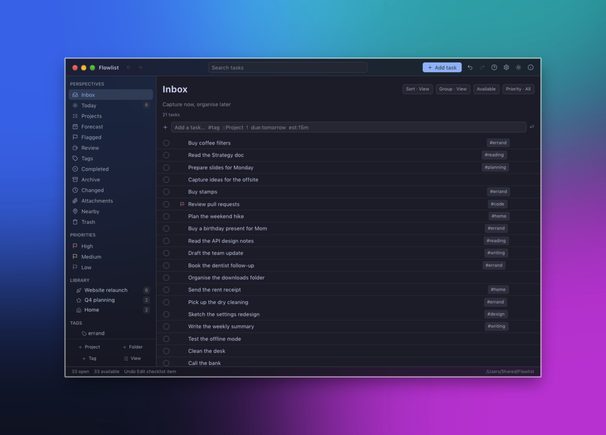

# Flowlist

**A fast, local-first task manager for macOS.** Inbox, projects, tags, repeats,
reviews and a floating capture panel in one native window. The same library is
available from the `flowlist` CLI and an MCP server for AI assistants.

**[Download Flowlist 0.1.0](https://github.com/Vulkan1125/flowlist/releases/latest)**
· [Wiki](https://github.com/Vulkan1125/flowlist/wiki)
· [Using the GUI](https://github.com/Vulkan1125/flowlist/wiki/Using-the-GUI)
· [CLI](https://github.com/Vulkan1125/flowlist/wiki/Using-the-CLI)
· [MCP](https://github.com/Vulkan1125/flowlist/wiki/Using-the-MCP)



*Pictured in Catppuccin. Plain is the default; all eleven theme families are in
Settings → Appearance.*

## Install

1. Download **Flowlist-0.1.0.zip** from the latest release.
2. Unzip it and move **Flowlist.app** to `/Applications`.
3. The first time, right-click the app and choose **Open**. The build is
   ad-hoc signed and not notarised, so macOS asks once.
4. Requires macOS 13 or later.

Your library lives in `~/Library/Application Support/Flowlist`. Nothing is
uploaded; there is no account, no sync service and no telemetry.

## What you get

- **One window for the day.** Inbox, Today, Forecast (with a month calendar),
  Review, Projects, Tags, Flagged, Completed, Archive, Trash and your saved
  perspectives.
- **Capture without breaking flow.** `⌃⌥Space` opens a floating parser anywhere:
  `Draft the launch email ::Website #writing due:friday est:45m` becomes a filed
  task, then returns you to the app you were in.
- **Real projects.** Parallel, sequential and single-action projects, folders,
  nested tags, subtasks, repeats that spawn the next occurrence, and review
  schedules you can change later.
- **An inspector that earns its space.** Notes, priority, checklist, subtasks,
  attachments, dates and repeat rules in place. Images and PDFs preview in the
  window instead of opening another app.
- **Glass and colour.** Eleven theme families, Plain light/dark with nine
  accent presets, a custom colour picker and a screen eyedropper.
- **Keyboard-first, undo everywhere.** Vim motions are on by default; every
  edit, drag, import and tool call is one `⌘Z` away.
- **Updates in the app.** Settings → About checks the latest release and
  installs it in place.

## Three ways to use it

| Surface | Start it with | Good for |
| --- | --- | --- |
| Desktop app | `open /Applications/Flowlist.app` | planning, dragging, reviewing |
| CLI | `…/Flowlist.app/Contents/MacOS/flowlist` | scripts and terminal habits |
| MCP server | `…/flowlist mcp` | letting an AI assistant read and change the library |

All three use the same library and the same undo history.

## Capture

The floating panel opens from any app with **`⌃⌥Space`**, or from the title bar
inside Flowlist. It parses as you type and shows where the task will land.

| Syntax | Meaning |
| --- | --- |
| `#writing`, `#work/website` | tag, created if missing |
| `::Website`, `::Work/Website` | project, created if missing |
| `due:friday`, `defer:tomorrow` | dates; wrap phrases with spaces in parentheses |
| `est:45m`, `est:2h30m` | estimate |
| `repeat:every week` | repeat rule |
| `!` | flag |
| `// ask Sam` | note |

Press `Enter` to file and return to the previous app, `⇧Enter` to keep
capturing, or `⌘Enter` to file and select the task in the main window.

## Quick start in the terminal

```sh
FLOWLIST="/Applications/Flowlist.app/Contents/MacOS/flowlist"

"$FLOWLIST" add 'Draft the launch email #writing ::Website due:friday est:45m'
"$FLOWLIST" list --today
"$FLOWLIST" done <ID>
"$FLOWLIST" review
"$FLOWLIST" undo
```

Add `--json` to any command for scripts. `FLOWLIST_HOME` or `--data-dir` points
the CLI at another library. The full command reference is in the
[CLI guide](https://github.com/Vulkan1125/flowlist/wiki/Using-the-CLI).

## Let an assistant use it

Run `flowlist mcp` from an MCP client and it gets tasks, projects, tags,
checklists, reviews, search, stats and undo over stdio — the same store as the
window.

```json
{
  "mcpServers": {
    "flowlist": {
      "command": "/Applications/Flowlist.app/Contents/MacOS/flowlist",
      "args": ["mcp"]
    }
  }
}
```

Then ask things like *“Add a task to Website relaunch, due Friday”* or *“What’s
due today?”*. See the
[MCP guide](https://github.com/Vulkan1125/flowlist/wiki/Using-the-MCP) for the
tool list and examples.

## Keyboard

| Shortcut | Action |
| --- | --- |
| `⌃⌥Space` | capture from any app |
| `n` / `⌘N` | capture |
| `/` or `⌘F` | search |
| `⌘⇧F` | search this view or the whole library |
| `space` | complete or reopen |
| `!` / `⌘D` | flag |
| `⏎` | edit the title |
| `Tab` / `⇧Tab` | nest / unnest |
| `⌘I` | toggle the inspector |
| `⌘Z` / `⇧⌘Z` | undo / redo |
| `⌘,` | settings |
| `?` | full keyboard help |

## Documentation

- [Wiki home](https://github.com/Vulkan1125/flowlist/wiki)
- [Using the GUI](https://github.com/Vulkan1125/flowlist/wiki/Using-the-GUI)
- [Using the CLI](https://github.com/Vulkan1125/flowlist/wiki/Using-the-CLI)
- [Using the MCP server](https://github.com/Vulkan1125/flowlist/wiki/Using-the-MCP)
- `docs/` in this repository for design notes, packaging and testing

## Build from source

Requires Rust 1.88+ and macOS 13+.

```sh
cargo build --release
./target/release/flowlist gui
```

`scripts/package.sh` builds `dist/Flowlist.app` and the release zip used by the
in-app updater. `cargo test --workspace` runs the suite.

## License

MIT
