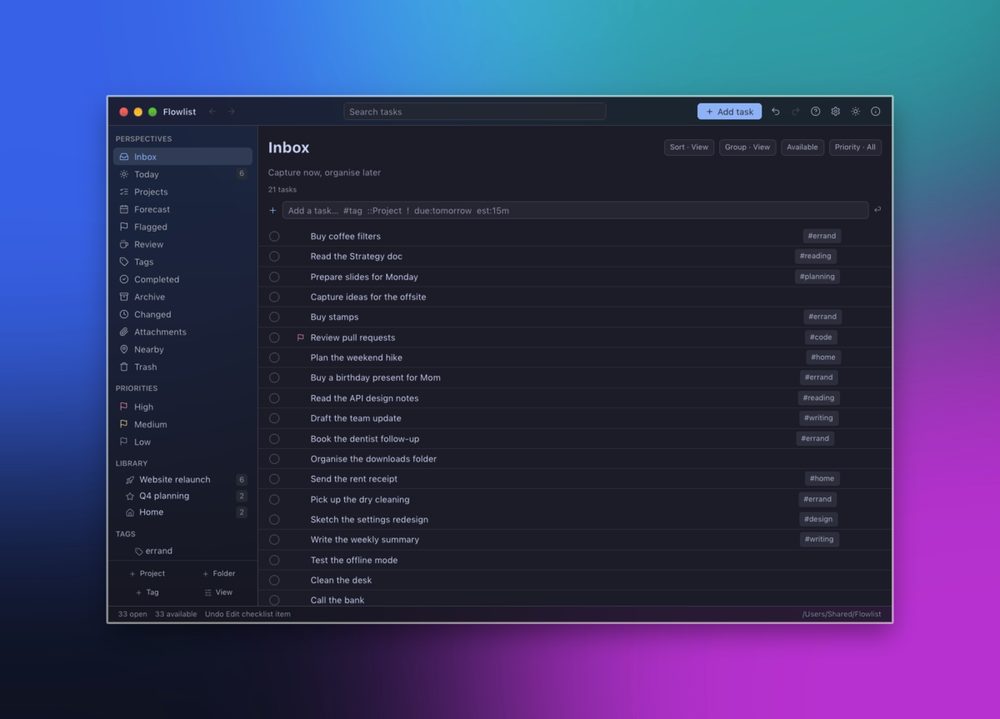

# Flowlist

**A fast, local-first task manager for macOS and Android.** One window, one
library file, and the same tasks from the desktop app, a phone, the `flowlist`
command line and an MCP server for AI assistants.

Nothing leaves your Mac. There is no account, no sync service and no telemetry.

> **AI-written documentation.** This wiki was written with AI assistance and may
> contain mistakes or lag behind the app. The app and its release notes are the
> source of truth. Please report corrections on the
> [issue tracker](https://github.com/Vulkan1125/flowlist/issues).



*The Inbox in the Catppuccin theme. Plain is the default; all eleven families
are in Settings → Appearance.*

## Install

1. Download **Flowlist-0.9.37.dmg** (or the zip) from the
   [latest release](https://github.com/Vulkan1125/flowlist/releases/latest).
2. Open the DMG and drag **Flowlist** to Applications, or unzip and move the
   app yourself.
3. The first time, right-click the app and choose **Open**. The build is
   ad-hoc signed and not notarised, so macOS asks once.
4. In Flowlist, open **Settings → About → Command line → Install
   command-line tool** so `flowlist` works in Terminal.
5. Requires macOS 13 or later.

Flowlist keeps its library in
`~/Library/Application Support/Flowlist`. Move the folder to a synced disk and
point Flowlist at it if you want the same library on more than one Mac; do not
let two machines write to it at the same time.

## Android

Download **Flowlist-Android-0.9.37.apk** from the same release, install it, then
open **Settings → Mobile** on the Mac and turn on **Serve to my phone**. Enter
one of the addresses and the pairing code in the app. See
[Using the phone](Using-the-Phone) for the full walkthrough.

## Four ways to use it

| Surface | Open it with | Good for |
| --- | --- | --- |
| Desktop app | `open /Applications/Flowlist.app` | day-to-day planning, dragging, reviewing |
| Android | install `Flowlist-Android-0.9.37.apk` | capture and checking off away from the Mac |
| CLI | `/Applications/Flowlist.app/Contents/MacOS/flowlist` | scripts, terminal habits, bulk edits |
| MCP server | `…/flowlist mcp` | letting an AI assistant read and change the library |

All four share one library and one undo history: a task captured on the phone
can be completed in the terminal, and `⌘Z` in the app can undo
the terminal's change.

## Start here

- **[Using the GUI](Using-the-GUI)** — capture, the inspector, projects,
  views, search, settings and the keyboard.
- **[Using the CLI](Using-the-CLI)** — add, list, edit, complete, review,
  search, export, and script it with `--json`.
- **[Using the MCP server](Using-the-MCP)** — connect an assistant and ask it
  to plan your day.

## The window at a glance

- **Left rail** — Inbox, Today, Forecast, Review, Projects, Tags, Flagged,
  Completed, Changed, Archive, Trash, plus your folders and saved views.
- **Middle pane** — the list. Every row has one checkbox, one title and its
  metadata; click the title to edit it.
- **Right inspector** — everything about the selected task: notes, priority,
  checklist, subtasks, attachments, tags, project and dates. Toggle it with
  `i` or `⌘I`.
- **Title bar** — search, **Add task**, undo and the current theme.

## Capture from anywhere

Press **`⌃⌥Space`** in any app. A small panel appears over what you are doing,
parses the line as you type, and files it without bringing the main window
forward.

```text
Draft the launch email #work/website ::Website due:friday est:45m // ask Sam
```

`#tag`, `::project`, `due:` / `defer:`, `est:`, `repeat:` and `!` all work in
the same line. Press `Enter` to file and return to the previous app.

## Updates

Open **Settings → About** (`⌘,` then `⌘6`) and choose **Check for updates**.
When a newer release exists, **Install update** downloads it, swaps the app in
place and offers **Restart Flowlist**.

## Common shortcuts

| Shortcut | Action |
| --- | --- |
| `⌃⌥Space` | capture from any app |
| `n` or `⌘N` | capture |
| `/` or `⌘F` | search |
| `⌘⇧F` | search this view or the whole library |
| `space` | complete or reopen |
| `!` or `⌘D` | flag |
| `⏎` | edit the title |
| `Tab` / `⇧Tab` | nest / unnest |
| `⌘I` | toggle the inspector |
| `⌘Z` / `⇧⌘Z` | undo / redo |
| `⌘,` | settings |
| `?` | keyboard help |

Vim motions are on by default: `j`/`k`, `h`/`l`, `gg`/`G`, `o`, `x`, `dd`,
`u` and counts work across the window. Turn them off in **Settings → Workflow**.
