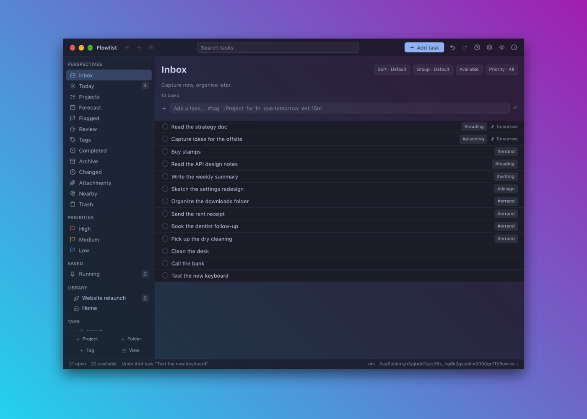
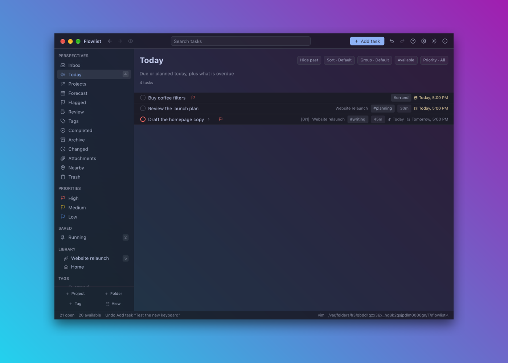
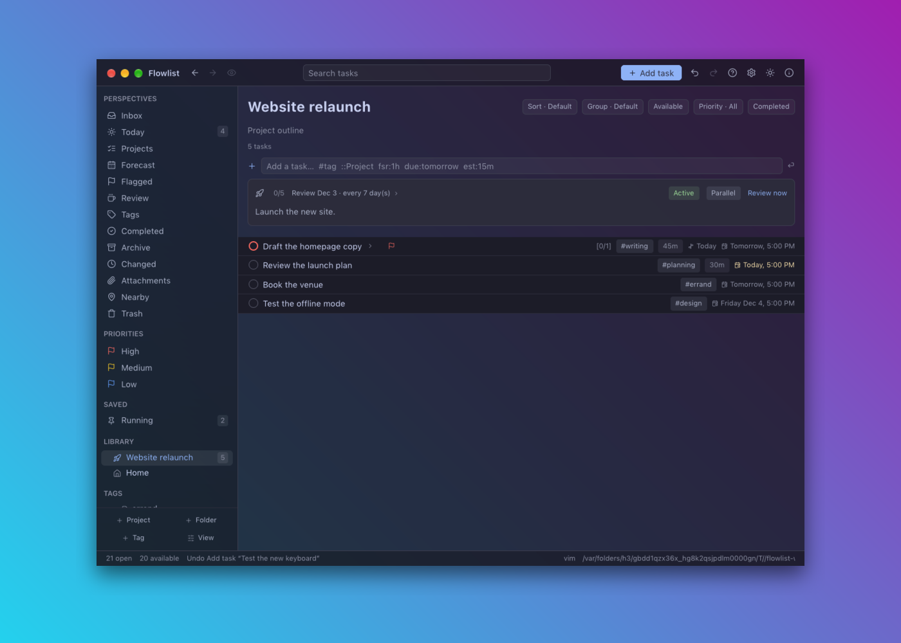
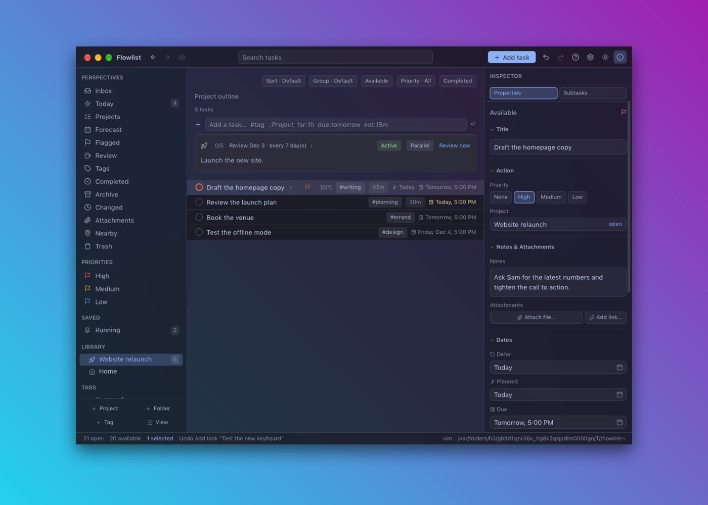
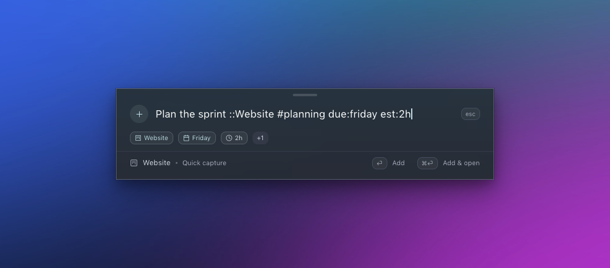
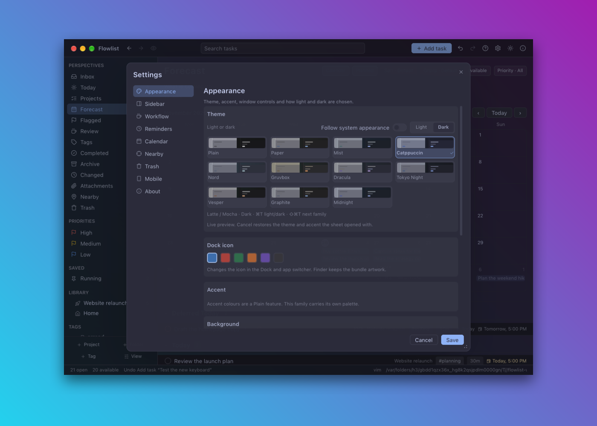
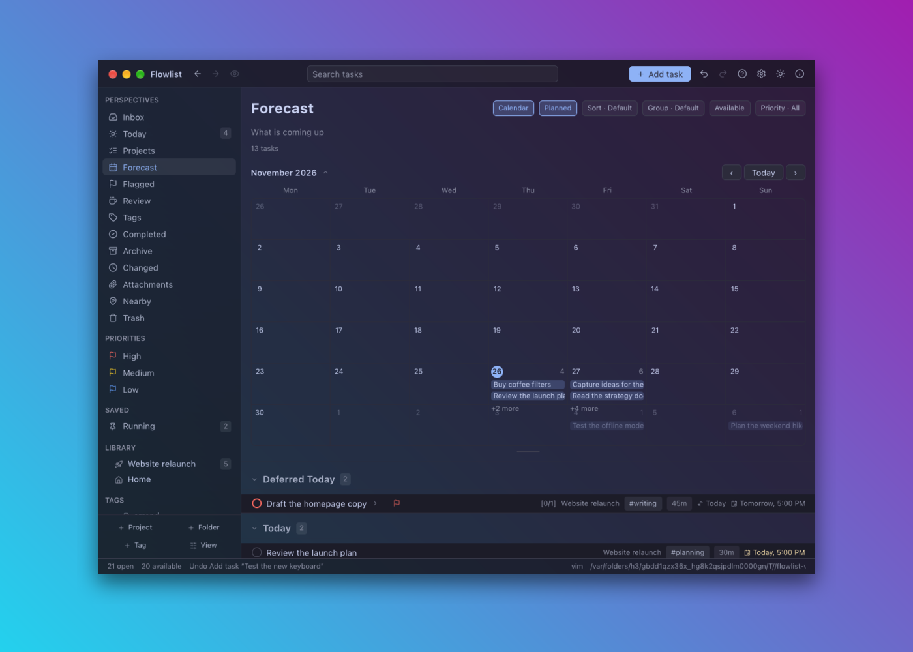
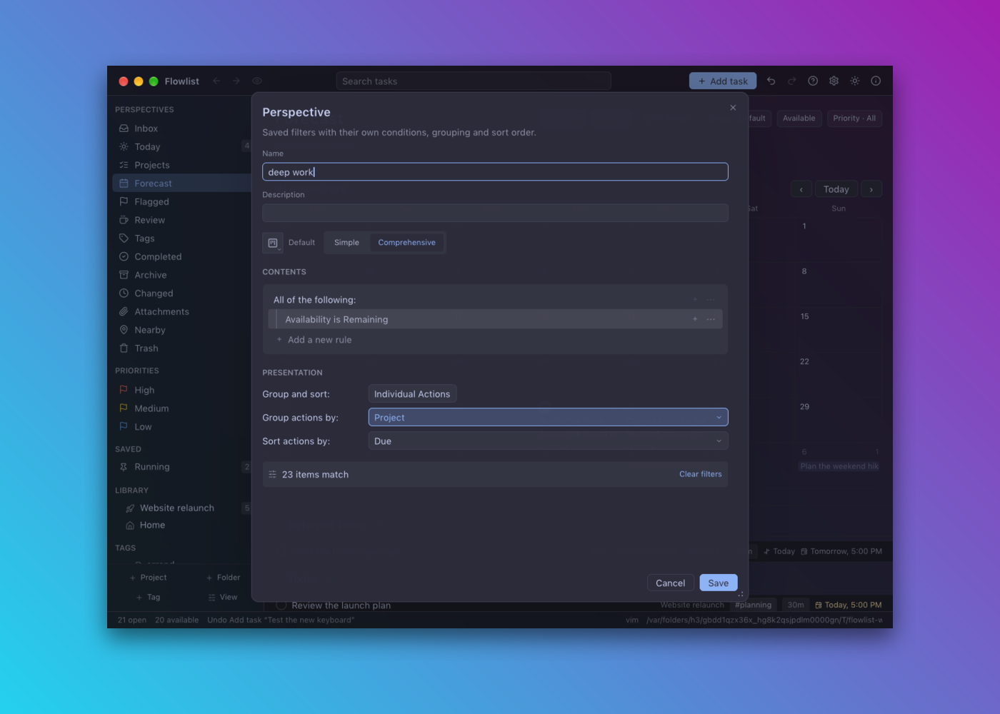

# Flowlist

**A local-first task manager for macOS and Android, with a command line and an
MCP server for AI assistants.** One library file, one undo history, and the
same work from the desktop, a phone, the terminal or an assistant.

Nothing leaves your Mac unless you point the Android server at your local
network. There is no account, no sync service and no telemetry.

> **AI-written documentation.** This wiki was written with AI assistance and may
> lag behind the app. The app and its release notes are the source of truth.
> Report corrections on the
> [issue tracker](https://github.com/Vulkan1125/flowlist/issues).

*The Inbox in the Catppuccin theme. Plain is the default; all eleven families
are in Settings → Appearance.*

## Why GTD?

Getting Things Done is a simple promise: **your mind is for having ideas, not
holding them**. Every unfinished commitment is an open loop, and open loops
consume attention until they are captured somewhere trusted.

GTD works in five moves:

1. **Capture** anything that has your attention.
2. **Clarify** what it means and what the very next action is.
3. **Organize** it where you will look when the situation is right.
4. **Reflect** regularly so the system stays trustworthy.
5. **Engage** with confidence, because you know nothing has been forgotten.

The method is not a pile of folders. It is a trusted system that lets you stop
rehearsing the same unfinished thought.

## How Flowlist approaches GTD

Flowlist keeps the method visible without turning it into ceremony.

| GTD practice | How Flowlist supports it |
| --- | --- |
| **Capture** | Global quick capture, the Inbox, quick-entry syntax and the Android app. |
| **Clarify** | The inspector turns a captured line into a real task: project, parent, tags, dates, estimate, priority, repeat, notes, checklist and attachments. |
| **Organize** | Folders, projects, action groups and nested tags. Defer, planned and due dates separate “when it appears” from “when it is due.” Saved views hold repeatable filters. |
| **Reflect** | Review keeps project cadences. Forecast, Completed, Changed and Archive show what moved. The weekly review is a first-class view, not a spreadsheet. |
| **Engage** | Today, Flagged, Forecast, Tags, Nearby, custom views, Focus mode and Available / First Available filters keep the list to what can be done now. |
| **Trust** | One local JSON library, undo and redo, backups, import/export, `doctor`, and the same history across the app, CLI, phone and MCP server. |

## One library, four surfaces

| Surface | Open it with | Best for |
| --- | --- | --- |
| **Desktop app** | `open /Applications/Flowlist.app` | planning, dragging, reviewing, deep editing |
| **Android app** | the phone build paired with the Mac | capture and checking off away from the desk |
| **CLI** | `flowlist` after **Settings → About → Install command-line tool** | scripts, bulk edits, terminal habits |
| **MCP server** | `flowlist mcp` | letting an AI assistant read and change the same library |

All four share one library and one undo history. A task captured on the phone
can be completed in the terminal, and `⌘Z` in the app can undo the terminal’s
change.

## A tour

### Inbox

The Inbox is for capture, not for storage. Process it until it is empty.

### Today

Today gathers overdue work, work due today, work deferred to today and planned
today.

### Projects

Projects hold an outline of tasks. They can be parallel, sequential or a
single-actions list, and they can live in nested folders.

### Inspector

The inspector is the full record: notes, tags, dates, repeat, priority,
checklist, subtasks, attachments and notifications.

### Capture

Press `⌃⌥Space` anywhere. One line can carry a tag, a project, dates, an
estimate, a repeat rule, a flag and a note.

### Settings

Settings covers appearance, the sidebar, workflow, reminders, Calendar,
Nearby, Trash, Mobile and About.

### Forecast

Forecast combines the month grid, the day list and Calendar events, with
separate dates for defer, planned and due.

### View editor

Saved views have a Simple tab for common filters and a Comprehensive tab for
the full rule tree, project rules, date ranges and comments.

## Feature map

### Capture and the Inbox

- Global quick capture with `⌃⌥Space`.
- Natural-language quick entry: `#tag`, `::Project`, `due:`, `defer:`,
  `planned:`, `est:`, `repeat:`, `!` and `// note`.
- Inbox rows for tasks that do not belong to a project yet.
- Drag and drop into projects, folders and other tasks.

### Tasks and action groups

- Titles, notes, project, parent task, tags, dates, estimate, priority and flag.
- Parallel or sequential action groups.
- Checklist steps that stay inside a task instead of becoming separate work.
- Repeat rules with intervals, weekdays and anchored dates.
- File and link attachments.
- Batch editing for several selected tasks in one undoable command.

### Projects, folders and tags

- Nested folders and projects.
- Project status: Active, On Hold, Done, Dropped.
- Project type: Parallel, Sequential, Single Actions.
- Review interval, next review and last reviewed.
- Nested tags with Available, On Hold and Dropped status, optional locations and
  usage counts.
- Per-project and per-task tags, with inheritance for filtering.

### Dates and availability

- **Defer** hides work until a date but keeps it in Remaining.
- **Planned** is a separate planning date that never changes availability.
- **Due** is the deadline.
- Availability states: First Available, Available, Remaining, Completed,
  Dropped.
- Due Soon uses the configurable window in **Settings → Workflow → Forecast**.

### Forecast and Calendar

- Today, tomorrow and later horizons.
- Month grid, week strip and day list.
- Read-only macOS Calendar events interleaved with tasks.
- Per-calendar visibility, with a separate Settings → Calendar section.
- Calendar event times shown as `start – end` on one line.

### Review

- Projects due for review, grouped by cadence.
- Mark reviewed and schedule the next review.
- Review interval, next review and last reviewed in the inspector.

### Saved views

- Two editor tabs: **Simple** and **Comprehensive**.
- Nested All / Any / None groups.
- Status, availability, duration, date range, tag status, tag any/all, project
  status, structure, containment, search terms and comments.
- Project rows for project-level rules.
- Disable, duplicate, reorder and drag rules into groups.
- Group by project, folder, tag, tags combined, due, defer, planned, completed,
  dropped, added, changed, next review, flagged or estimate.
- Sort by manual order, due, defer, planned, name, priority, flagged, estimate,
  created, completed, due & flagged, tag, added, changed, dropped or next
  review.
- Pinned views, custom icons and descriptions.

### Search and Focus

- Search tasks, projects, folders, tags and saved views.
- Scope search to the current view or the whole library.
- Focus mode narrows every perspective, search, Forecast and Review list to
  selected projects or folders.
- Sidebar multi-selection for focus and bulk project actions.

### Notifications and full-screen reminders

- Due, defer, planned and latest-start notifications.
- Relative alerts such as `due:-15m` and absolute custom notifications.
- One notification at a time can open full screen instead of as a banner.
- Configurable snooze, wallpaper, opacity and media pausing.
- Per-device Calendar and notification permissions.

### Archive, Trash and history

- Completed and Changed views.
- Archive for finished and dropped projects.
- Trash with restore, permanent delete, retention and empty-trash.
- Undo and redo across every surface.
- JSON and TaskPaper import/export.
- `doctor` for dangling references and ordering arrays.

### Interface

- Eleven theme families with light and dark modes and accent control.
- Icons-only header by default; titles available in Settings.
- Collapsible inspector sections.
- Resizable Settings and saved-view editor.
- Full keyboard access, Vim motions and a shortcut reference.

### Automation

- Complete CLI covering tasks, projects, folders, tags, perspectives, review,
  checklists, trash, history, import/export and server control.
- MCP server over stdio with task, project, tag, folder, review, checklist,
  trash, history, export and library tools.
- Android app that pairs with the Mac over the local network.

## Install

1. Download **Flowlist-0.10.0.dmg** (or the zip) from the
   [latest release](https://github.com/Vulkan1125/flowlist/releases/latest).
2. Open the DMG and drag **Flowlist** to Applications, or unzip and move the app
   yourself.
3. The first time, right-click the app and choose **Open**. The build is
   ad-hoc signed and not notarised, so macOS asks once.
4. Open **Settings → About → Command line → Install command-line tool** so
   `flowlist` works in Terminal.
5. Requires macOS 13 or later.

Flowlist keeps its library in
`~/Library/Application Support/Flowlist`. Move the folder to a synced disk and
point Flowlist at it if you want the same library on more than one Mac; do not
let two machines write to it at the same time.

### Android

The Android app pairs with the Mac over the local network. The **0.10.0**
release does not attach an APK because the Android build toolchain was not
available on the release machine; the last published phone build remains
available on the releases page. See [Using the phone](Using-the-Phone) for
pairing and the current limits.

## Keyboard shortcuts

| Shortcut | Action |
| --- | --- |
| `⌃⌥Space` | capture from any app |
| `n` or `⌘N` | capture |
| `/` or `⌘F` | search |
| `⌘⇧F` | search this view or the whole library |
| `space` | complete or reopen |
| `!` or `⌘D` | flag |
| `⏎` | edit the title |
| `Tab` / `⇧Tab` | nest / unnest |
| `⌘I` | toggle the inspector |
| `⌘Z` / `⇧⌘Z` | undo / redo |
| `⌘,` | settings |
| `?` | keyboard help |

Vim motions are on by default: `j`/`k`, `h`/`l`, `gg`/`G`, `o`, `x`, `dd`,
`u` and counts work across the window. Turn them off in **Settings → Workflow**.

## Documentation

- **[Using the GUI](Using-the-GUI)** — capture, inspector, projects, views,
  search, settings and keyboard.
- **[Using the CLI](Using-the-CLI)** — every command and flag, with examples.
- **[Using the phone](Using-the-Phone)** — pairing, capture and the mobile
  limits.
- **[Using the MCP server](Using-the-MCP)** — connect an assistant and use the
  full tool catalogue.
