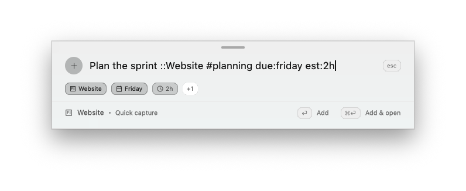
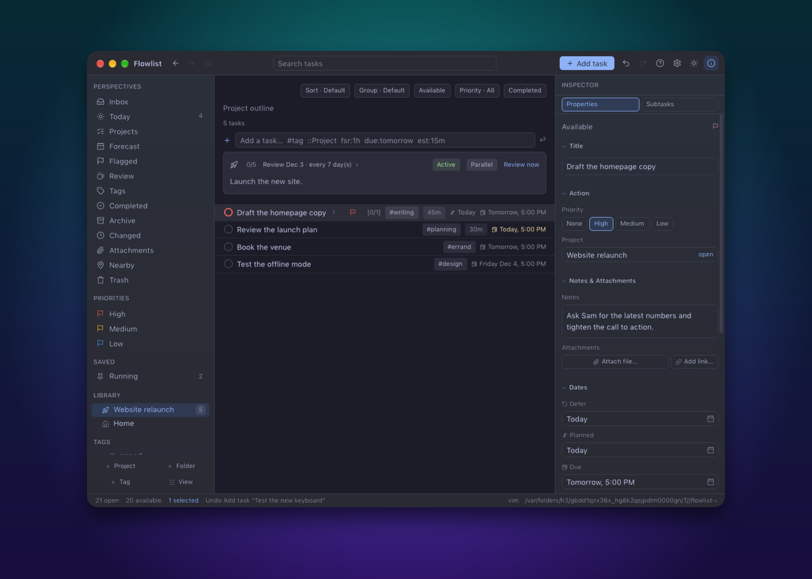
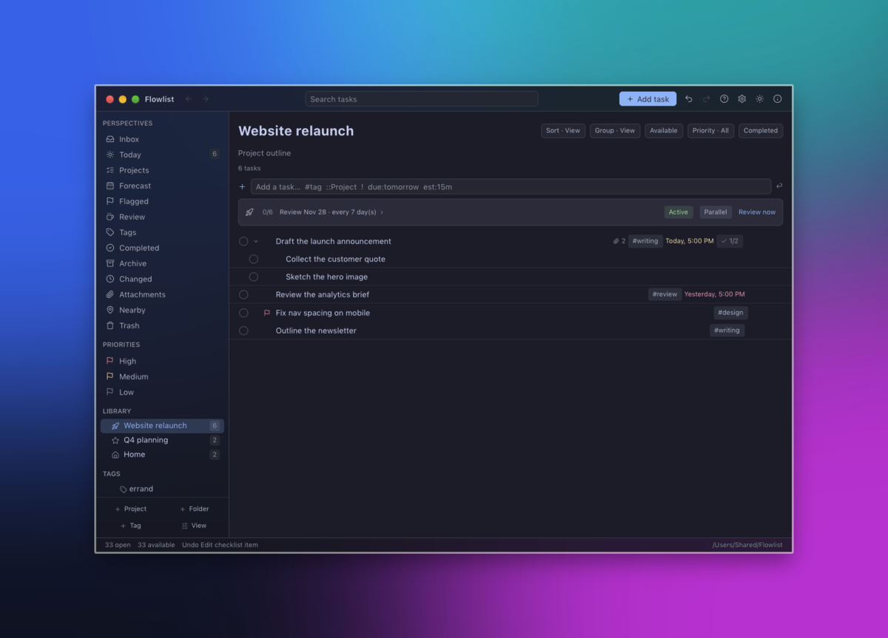
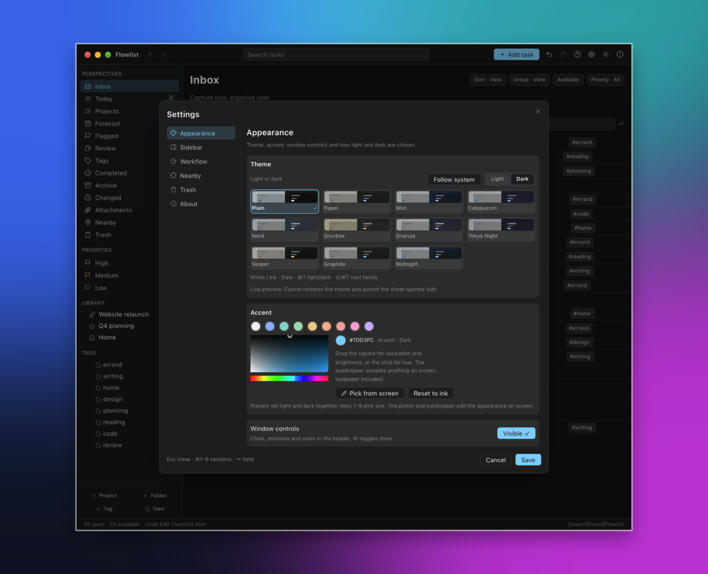

# Using the GUI

Open `/Applications/Flowlist.app`. The window restores the view, selection,
theme and size you left it with.

*The screenshots here use the Catppuccin theme; the Settings shot shows Plain's
accent picker. Every family is one click away in Settings → Appearance.*

## Capture

There are three ways to add a task:

- **`⌃⌥Space`** from any app opens the floating capture panel over what you are
  doing. The main window stays where it is.
- **Add task** in the title bar opens the same panel over the Flowlist window.
- **`n`** puts the caret in the capture bar at the top of the list, when the
  view has one.

The line is parsed as you type, and the chips under it show where the task will
land. A plain thought goes to the Inbox; `::Project` files it into a project;
`due:` and `defer:` schedule it into Today or Forecast.

| Text | Meaning |
| --- | --- |
| `#writing`, `#work/website` | tag (nested tags are created as needed) |
| `::Website`, `::Work/Website` | project (created if missing) |
| `due:friday`, `defer:tomorrow`, `due:(next monday 9am)` | dates |
| `est:45m`, `est:2h30m` | estimate |
| `repeat:every week` | repeat rule |
| `!` | flag |
| `// ask Sam` | note |

In the panel:

| Key | Action |
| --- | --- |
| `Enter` | file the task and return to the previous app |
| `⇧Enter` | file it and stay open for the next thought |
| `⌘Enter` | file it and select it in the main window |
| `Esc` / `⌘W` | close without filing |

Every capture is undoable with `⌘Z`, even after the panel has closed.

## Tasks

- Click the circle to complete or reopen a task; `space` does the same to the
  selected row.
- Click a title to edit it inline. `⏎` starts editing; `Esc` cancels.
- Drag a task onto a project, a tag, another task (to make it a subtask) or
  between siblings to reorder it. Every drop is undoable.
- `Tab` / `⇧Tab` nest and unnest the selection. `⌥↑` / `⌥↓` move it among its
  siblings.
- `Tab` indents the selected task under the task above; `⇧Tab` outdents it.
- A task circle takes a vivid priority colour: red for high, yellow for medium
  and blue for low. Priority rings are a little thicker than neutral circles so
  the signal reads clearly on every theme. Completed tasks keep the filled
  accent check. The title starts just after the circle with a little breathing
  room. The subtask chevron sits immediately beside the title, and the flag
  follows one circle width later; without a chevron the flag keeps the same
  one-circle gap from the title. That gap is part of the chevron's click
  target, so the small chevron is easier to hit.
- Subtasks start collapsed. The chevron on a parent opens and closes them; `za` toggles, `zo`
  opens and `zc` closes.
- Flag with `!` or `⌘D`; the flag sits left of the title and shows on hover in
  an idle list.
- Select several rows with `⇧↑` / `⇧↓`, `⌘`-click or a drag; bulk complete,
  flag, move and delete work on the whole selection.

The right edge of each row reads in one order: attachments, project, `#tag`
chips, estimate, due date, deferred date and repeat.

## The inspector

Toggle the inspector with `i` or `⌘I`. It edits the selected task without
leaving the list.

- **Title, notes, estimate, repeat** are editable fields. `Tab` / `Enter`
  saves the field and moves to the next one; `Esc` cancels the field.
- **Priority** is a **None** chip plus High, Medium and Low. Click **None** to
  clear it. Changing the priority of a repeating task opens a small sheet:
  apply it to **This occurrence** or the **Whole series**. Future occurrences
  inherit the series priority.
- **Subtasks** are an inline list: tick a child, click its title to open it,
  drag the grip to reorder, or type in the field at the bottom to add one. The
  step-type chips, the subtask rows and the add field have clear space between
  them.
  **Separate** moves a child to the end of the project (or the Inbox). You can
  also press `Tab` to indent the selected task under the one above, or drag a
  task onto another task.
- **Editing text** uses a real caret. Click to place it, double-click to select
  a word, triple-click to select everything, or drag to select a run. The
  add-subtask field and the sheet fields follow the same mouse rules.
- **One step type per task.** Choose **Parallel**, **Sequential** or
  **One-off**. Parallel and Sequential show child tasks; One-off shows
  checklist-style steps that tick, drag and delete in place and never appear as
  tasks. In Sequential, only the first incomplete child can be ticked; later
  rows are dimmed and name the task that must finish first.
- **Converting to one-off asks first.** Each child becomes a checklist step.
  Task-only details such as notes, dates, tags and priority are removed; the
  title and completion state stay. Switching back restores each step as a
  subtask.
- **Drag a subtask out of its parent** by dropping it on the lower third of a
  root-level task in the middle pane (or in a gap between root tasks). The row
  tints to show the target, and the task becomes a top-level task beside it.
- **Attachments** accept files and `http(s)` links. Click a file's name to
  preview an image or PDF in the app; PDFs step with `←` / `→`. `open` hands the
  file to its default app. Removing an attachment asks first and leaves the
  file on disk; Undo restores the row.
- **Tags**, **Project**, **Defer**, **Due**, **Estimate** and **Repeat** are
  one click away. A date opens a calendar and a clock-face time picker. A
  defer date after the due date is refused with a toast, so the picker stays
  open for another choice.
- **To project** converts the task and its subtasks into a project. **Delete**
  and **Complete** finish the task.

## Projects and reviews

Create a project with `⇧⌘N` (or **＋ Project** at the bottom of the rail). A
project can be **Parallel** (all tasks available), **Sequential** (one at a
time) or single-action, and Active, On hold, Done or Dropped. Projects live in
folders and can carry their own tags, dates, attachments and icon.

- The banner shows progress, the next review date, the status and the project
  type.
- Click **Review now** after a review; the next date moves on by the project's
  interval.
- Click the review line (*Review Nov 28 · every 7 day(s)*) to change the
  interval later. The same line in the inspector opens the same sheet.
- Drag a project onto a folder, onto the LIBRARY heading or onto empty space to
  move it back to the root.

## Views

The rail is the map of the library:

| View | Shows |
| --- | --- |
| **Inbox** | unscheduled tasks — no project, no due or defer date |
| **Today** | due today, deferred to today, and overdue |
| **Forecast** | the month calendar and upcoming dated work |
| **Review** | projects whose review date has arrived |
| **Projects** | every project at a glance |
| **Tags** | tasks grouped by context |
| **Flagged** | everything marked `!` |
| **Completed** | recently finished tasks |
| **Changed** | recently edited tasks |
| **Archive** | finished and dropped projects |
| **Trash** | deleted tasks, restorable until the retention window ends |
| **Attachments** | open tasks with files or links |
| **Nearby** | tags with a location, ranked by distance |

`⌘1`…`⌘8` jump between the built-in views. The back and forward arrows (`⌘[` /
`⌘]`) walk the views you visited.

## Search

Press `/` or `⌘F`. Matching is fuzzy: `bcf` finds “Buy coffee filters”, and
typing a project name finds its tasks. Search reads titles, notes, tags and
project paths.

The scope chip under the view title switches between **This view** and
**Library**, as does `⌘⇧F`. A library search looks at every task outside Trash,
titles itself **Search** and ranks the closest matches first.

## Organising

- **New project / folder / tag / perspective**: `⇧⌘N`, `⌥⌘N`, `⌃⌘N`, `⇧⌘P`.
- **Saved perspectives** share one editor with the phone: text, Inbox only,
  Flagged only, Status, Projects, Tags with child tags, Priorities, Due and
  Defer windows, full-screen reminder marks (yes or no, including inherited
  marks), an estimate range, grouping and sorting, and completed tasks.
  Both platforms offer project/folder/tag/due/defer/flagged/estimate grouping
  and manual/due/defer/name/priority/flagged/estimate/created/completed sorting.
  Project grouping puts tasks with no project under **No project** instead of an
  Inbox heading.
- Right-click a sidebar row for Open, Rename, Delete, New child, project status
  and tag location. Rename is also `⌘R`.
- Drag tasks between projects, tags and parents; drag projects into folders.
- **Sort** and **Group** chips at the top of the list open a menu of orders.
  **Available** keeps only tasks you can start now; **Priority** filters by
  priority. The choices are remembered per view.
- The **Calendar** chip in Forecast hides and restores the calendar, and
  remembers whether it was the week strip or the full month. Hiding also clears
  any picked day, so the list always returns to the full agenda. The chevron
  beside the month name folds the full month to the current-week strip; the
  strip's chevron opens the full month again. The week strip remembers the week
  it was on, moves one Monday-first week at a time (forward only) with the
  arrows or horizontal scroll, and keeps the selected weekday; clicking the
  selected day again clears the filter. While a day is picked, the count under
  the view title names it, as in “1 task for 23 Nov”. The full month is
  unchanged, including its bottom resize grip.

## Undo

Every mutation is undoable: edits, completions, drags, imports, trash, even a
theme change. Press `⌘Z`, or use the arrow in the title bar. `⇧⌘Z` redoes.
The status bar names the last action and its Undo until the next one.

## Settings

Press `⌘,`. The sheet opens at a fixed size and can be resized from the grip in
its bottom-right corner. When the content no longer fits, a thin Zed-style
scrollbar appears along the right edge; drag its thumb or click the track to
move. The section rail stays put while the chosen section scrolls. It has
eight sections on the left (`⌘1`…`⌘8` jump between them):

- **Appearance** — theme family, light/dark, Plain's accent presets and custom
  colour picker, screen eyedropper, six Dock icon colours, separate light and
  dark wallpapers with a shared opacity, and the window controls.
- **Sidebar** — a collapsible matrix of every rail item with **Hide** and **Hide count** boxes, indented under their heading. Every heading starts collapsed and opening one closes the rest. A ticked box hides the row and strikes its name through; hiding a row also greys out its count box, since a count on a hidden row makes no sense. Inbox, Today and Trash always stay and have no Hide box at all. Saved perspectives show their open count, or a bare tick when nothing matches. **Hide empty custom views** drops a saved view from the rail while its filter matches nothing and brings it back as soon as a task does.
- **Workflow** — Vim mode, macOS due reminders, and the review/changed/completed windows.
- **Nearby** — the radius used by the Nearby view.
- **Trash** — how many days deleted tasks stay restorable.
- **Mobile** — the phone server, pairing code, addresses and paired devices.
- **About** — version, library folder, GitHub and wiki links, and the update
  check.

### Reminders

**Settings → Reminders** (its own sidebar item) can schedule a macOS notification for every
task due in the next 30 days. Timestamped tasks remind at their time; date-only
tasks remind at 09:00 local. Toggling it on asks macOS for permission, and
**Send test** checks that banners are working.

**Full-screen reminders** are opt-in per task, project or folder. Mark a task
in the inspector, or tick **Full-screen reminder** while capturing a task or
creating a project or folder. A marked task, and every task inside a marked
project or folder, opens a screen-sized reminder when it comes due while
Flowlist is running. Complete, Snooze, Open task and Dismiss are on that
screen; Dismiss and Esc leave the task alone. **S** cycles the snooze length,
**Enter** snoozes with it and **⌘Enter** completes the task.

The reminder sits on a theme-synced abstract backdrop by default. Pick another
abstract style from its preview, follow the current theme, or choose a
wallpaper from **Settings → Reminders → Reminder background**; the wallpaper has
its own opacity and a **Send full-screen test** button opens the reminder
screen directly.

When a task is marked for full-screen reminders, its inspector shows **Match
due date & time**. Leave it on to follow the due stamp, or turn it off and set
a separate reminder date and time. The date field is greyed out while it
follows the due stamp, and a reminder cannot be saved in the past. **Snooze
length** offers 15, 30 or 60 minutes. **Settings → Appearance → Background**
sets separate light and dark wallpapers behind the main window, sharing one
opacity choice.

macOS needs an Apple Development or Developer ID signature before it can grant
notification permission; the reminder window itself works while Flowlist is
running.

macOS only grants notification permission to a signed app. The downloadable
build is ad-hoc signed, so this sheet shows **Blocked for this ad-hoc build**.
Use an Apple Development or Developer ID certificate when packaging (`set
FLOWLIST_SIGN_IDENTITY=…` before `scripts/package.sh`) to enable reminders.

Changes preview live. **Cancel** puts back the theme, accent and window
controls the sheet opened with; **Save** keeps them.

## Keyboard

Press **`?`** for the full keyboard and mouse help. The essentials:

| Shortcut | Action |
| --- | --- |
| `↑` / `↓` | move the selection |
| `⇧↑` / `⇧↓` | extend the selection |
| `space` | complete or reopen |
| `!` / `⌘D` | flag or unflag |
| `⏎` | edit the title |
| `Tab` / `⇧Tab` | nest / unnest |
| `⌘Z` / `⇧⌘Z` | undo / redo |
| `⌘⌫` | delete the selection or sidebar item |
| `⌘L` | add a subtask |
| `⌘T` | toggle light / dark |
| `⇧⌘T` / `⌥⌘T` | next / previous theme |
| `⌘O` | import TaskPaper or JSON |
| `⌘,` | settings |

Vim mode is on by default and covers the list, sidebar and subtask field: `j`/`k`,
`h`/`l`, `gg`/`G`, `o`/`O`, `x`, `dd`, `yy`, `p`, `u`, `Ctrl-r`, counts and
`/` all work. Turn it off in **Settings → Workflow**.

## Remove Flowlist

Settings → About ends with a red **Danger zone** card. **Uninstall Flowlist…**
opens a sheet with two choices:

- **Keep my library** removes the app, the `flowlist` command and macOS
  support files, but leaves your tasks, history and backups in place.
- **Delete the app and all data** removes the library too.

Flowlist quits, a helper removes the files, and the result is logged to
`~/Library/Logs/Flowlist-uninstall.log` if anything could not be deleted.

## Empty states

Every empty view uses a quiet circular halo and a specific title, with no
illustration. The title names the view (“Inbox zero”, “Nothing flagged”, “Trash
is empty”) and the line below explains what will appear there.
