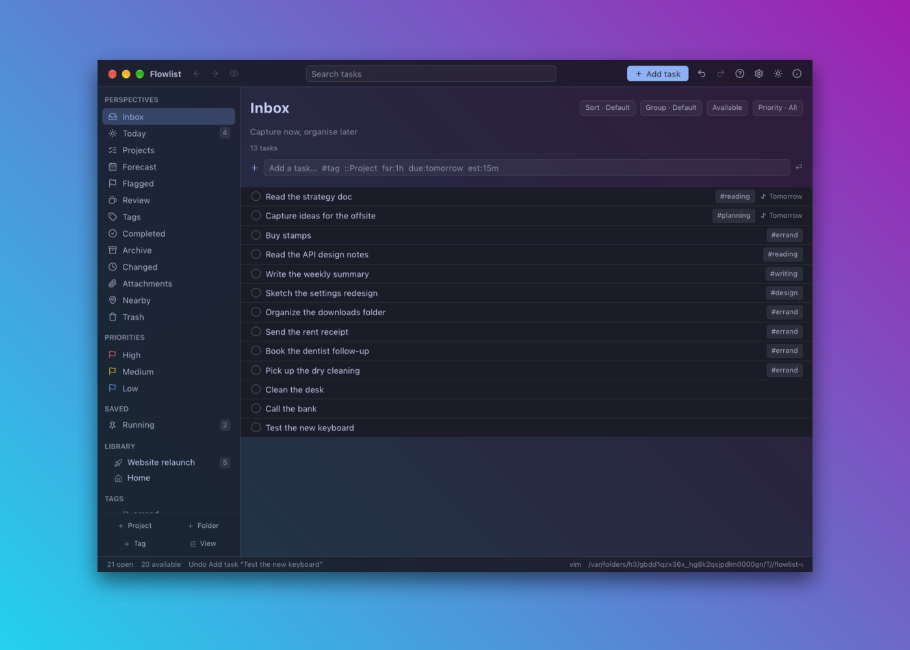
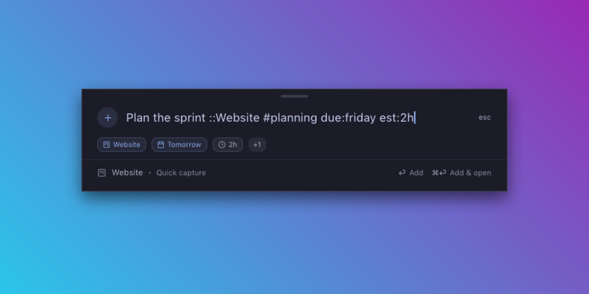
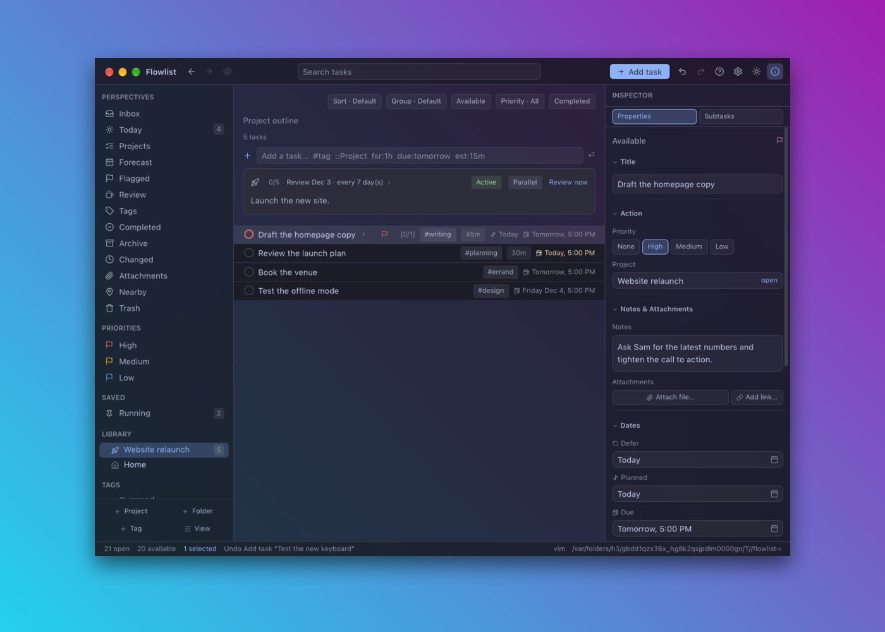
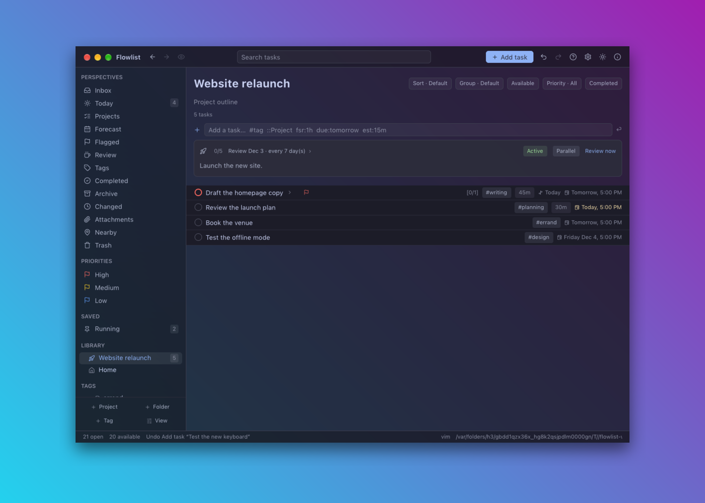
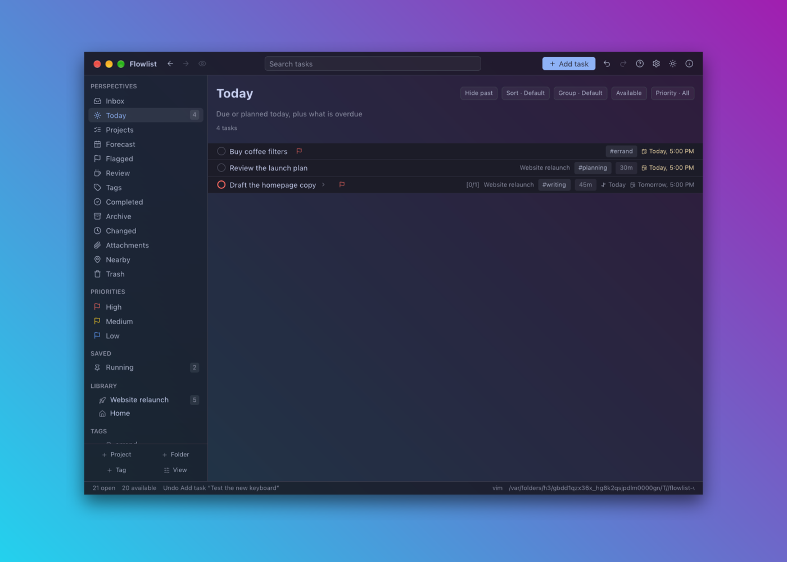
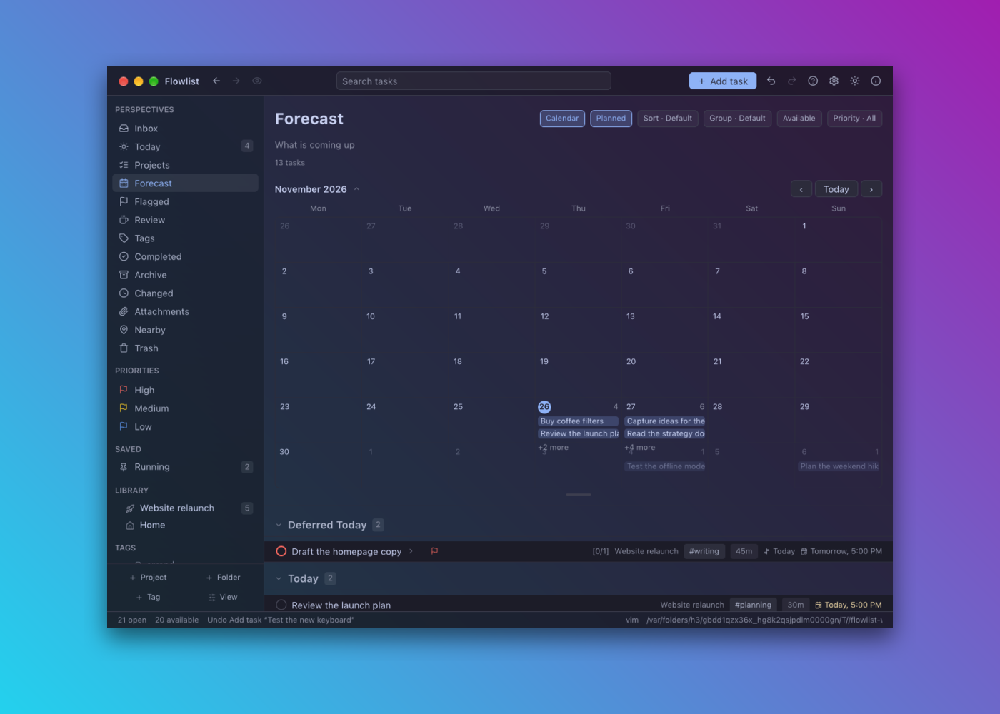
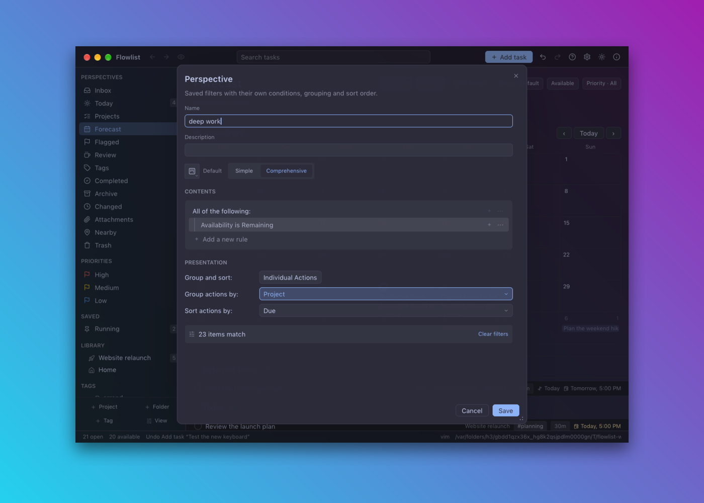
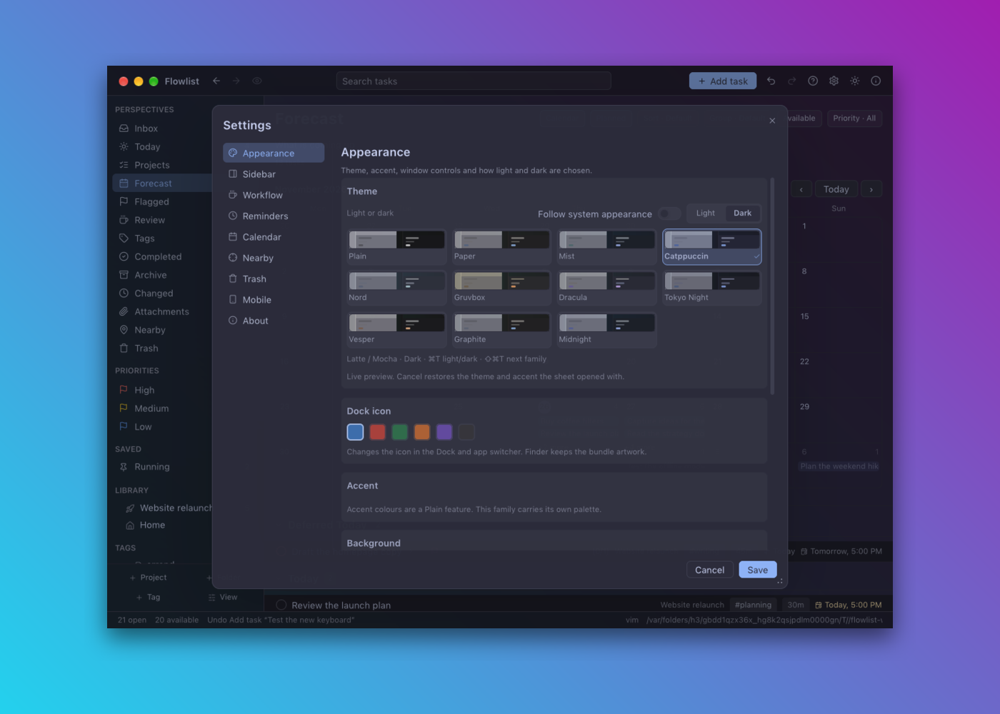

# Using the GUI

Open `/Applications/Flowlist.app`. The window restores the view, selection,
theme and size you left it with.

*The screenshots here use the Catppuccin theme; the Settings shot shows Plain's
accent picker. Every family is one click away in Settings → Appearance.*

## Capture

There are three ways to add a task:

- **`⌃⌥Space`** from any app opens the floating capture panel over what you are
  doing; press it again to put the panel away. The main window stays where it
  is.
- **`⌘O`** opens Quick Open, one palette for perspectives, folders, projects,
  tags and priorities. Type to filter; `↑`/`↓` move, `Return` opens and `Esc`
  closes.
- **Add task** in the title bar opens the same panel over the Flowlist window.
- **`n`** puts the caret in the capture bar at the top of the list, when the
  view has one.

The line is parsed as you type, and the chips under it show where the task will
land. A plain thought goes to the Inbox; `::Project` files it into a project;
`due:` and `defer:` schedule it into Today or Forecast; `planned:` records a
planning date without changing availability.

| Text | Meaning |
| --- | --- |
| `#writing`, `#work/website` | tag (nested tags are created as needed) |
| `::Website`, `::Work/Website` | project (created if missing) |
| `due:friday`, `defer:tomorrow`, `planned:(next monday)`, `due:3d` | dates |
| `fsr:1h30m`, `fsr:2d`, or bare `fsr` | full-screen reminder time; bare `fsr` follows due |
| `est:45m`, `est:2h30m` | estimate |
| `repeat:every week` | repeat rule |
| `!` | flag |
| `// ask Sam` | note |

In the panel:

| Key | Action |
| --- | --- |
| `Enter` | file the task and return to the previous app |
| `⇧Enter` | file it and stay open for the next thought |
| `⌘Enter` | file it and select it in the main window |
| `Esc` / `⌘W` | close without filing |

Every capture is undoable with `⌘Z`, even after the panel has closed.

## Tasks

- Click the circle to complete or reopen a task; `space` does the same to the
  selected row.
- Click a title to edit it inline. `⏎` starts editing; `Esc` cancels.
- Drag a task onto a project, a tag, another task (to make it a subtask) or
  between siblings to reorder it. Every drop is undoable.
- `Tab` / `⇧Tab` nest and unnest the selection. `⌥↑` / `⌥↓` move it among its
  siblings.
- `Tab` indents the selected task under the task above; `⇧Tab` outdents it.
- A task circle takes a vivid priority colour: red for high, yellow for medium
  and blue for low. Priority rings are a little thicker than neutral circles so
  the signal reads clearly on every theme. Completed tasks keep the filled
  accent check. The title starts just after the circle with a little breathing
  room. The subtask chevron sits immediately beside the title, and the flag
  follows one circle width later; without a chevron the flag keeps the same
  one-circle gap from the title. That gap is part of the chevron's click
  target, so the small chevron is easier to hit.
- Subtasks start collapsed. The chevron on a parent opens and closes them; `za` toggles, `zo`
  opens and `zc` closes.
- Flag with `!` or `⌘D`; the flag sits left of the title and shows on hover in
  an idle list.
- Select several rows with `⇧↑` / `⇧↓`, `⌘`-click or a drag; bulk complete,
  flag, move and delete work on the whole selection.

The right edge of each row reads in one order: attachments, project, `#tag`
chips, estimate, planned date, due date, deferred date and repeat. A plan that
has slipped shows its original date in the Past plans group rather than moving
forward. Each date
carries its own mark: a signpost for Planned, a clock on a calendar for Due and
a turning arrow for Defer; hovering names the field.

## The inspector

Toggle the inspector with `i` or `⌘I`. It edits the selected task without
leaving the list.

- **Title, notes, estimate, repeat** are editable fields. `Tab` / `Enter`
  saves the field and moves to the next one; `Esc` cancels the field.
- **Priority** is a **None** chip plus High, Medium and Low. Click **None** to
  clear it. Changing the priority of a repeating task opens a small sheet:
  apply it to **This occurrence** or the **Whole series**. Future occurrences
  inherit the series priority.
- The **Subtasks** tab is an inline list: tick a child, click its title to open
  it, drag the grip to reorder, or type in the field at the bottom to add one.
  The step-type chips, the subtask rows and the add field have clear space
  between them.
  **Separate** moves a child to the end of the project (or the Inbox). You can
  also press `Tab` to indent the selected task under the one above, or drag a
  task onto another task.
- **Editing text** uses a real caret. Click to place it, double-click to select
  a word, triple-click to select everything, or drag to select a run. The
  add-subtask field and the sheet fields follow the same mouse rules.
- **One step type per task.** Choose **Parallel**, **Sequential** or
  **One-off**. Parallel and Sequential show child tasks; One-off shows
  checklist-style steps that tick, drag and delete in place and never appear as
  tasks. In Sequential, only the first incomplete child can be ticked; later
  rows are dimmed and name the task that must finish first.
- **Converting to one-off asks first.** Each child becomes a checklist step.
  Task-only details such as notes, dates, tags and priority are removed; the
  title and completion state stay. Switching back restores each step as a
  subtask.
- **Drag a subtask out of its parent** by dropping it on the lower third of a
  root-level task in the middle pane (or in a gap between root tasks). The row
  tints to show the target, and the task becomes a top-level task beside it.
- **Attachments** accept files and `http(s)` links. Click a file's name to
  preview an image or PDF in the app; PDFs step with `←` / `→`. `open` hands the
  file to its default app. Removing an attachment asks first and leaves the
  file on disk; Undo restores the row.
- A selected task has two inspector tabs: **Properties** and **Subtasks**.
  Properties holds the fields below; Subtasks holds the subtask list and its
  Parallel / Sequential / One-off choice.
- Every Properties section has a disclosure triangle. Collapsing a section
  shortens the sheet without hiding the others, and the choice is remembered
  per device.
- **Tags**, **Project**, **Defer**, **Planned**, **Due**, **Estimate**,
  **Repeat** and **Notifications** are one click away. A date opens a calendar
  and a clock-face time picker. A defer date after the due date is refused with
  a toast, so the picker stays open for another choice. Planned never changes
  availability.
- **Repeat** uses compact controls: a repeat checkbox, one interval box
  with an editable number and a day/week/month/year dropdown, and segmented
  choices for **Due Date** or **Defer Until Date** and for **Completion** or
  **Assigned Dates**. When the unit is **Days**, a single Sunday-to-Saturday
  row appears. Leave it clear to repeat every day; select S/M/T/W/T/F/S to
  repeat only those weekdays. When weekdays are selected the interval bar shows
  a greyed-out “custom”. The line beneath says the result in plain words, such
  as “Every Monday and Wednesday, from the assigned dates, scheduling the next
  due date.”
- **Tags** is its own section above Notifications, with a bordered chip box and
  a `+` control. Clicking the box or `+` opens the add field; Enter adds the
  tag. **Notes & Attachments** sits in the old Tags position, before Dates.
- **Notifications** is the only place for alerts now. Add a default back, a
  relative alert or an absolute custom time from **Add Notification**; no
  separate Alerts field is needed. Every task notification has a checkbox on
  its right; the section says “Check a notification to show it full screen
  instead of as a banner”. Only one can be checked at a time.
- **Empty sections start folded.** For example, a task with no notes does not
  spend space on Notes & Attachments, and a task with no notifications folds
  that section until one is added.
- **To project** converts the task and its subtasks into a project. **Delete**
  and **Complete** finish the task.

## Batch editing

Select two or more tasks with `Cmd`-click or `Shift`-click. The inspector becomes
a batch editor for **Project**, **Tags**, **Defer**, **Planned**, **Due**,
**Priority**, **Flag** and **Estimate**.

- Empty fields stay unchanged.
- `none` or `clear` clears a date, project or estimate.
- Tags accept comma-separated names; prefix one with `-` to remove it.
- **Apply** changes every selected task in one undoable step. If strict project
  or parent dates reject any task, the entire batch rolls back and the reason
  stays in the inspector.

## Notifications

Notifications are built from three layers:

1. **Default notifications** in Settings → Reminders:
   - Defer
   - Planned
   - Latest start (due minus estimate)
   - Due
2. **Per-item notifications**, shown in the inspector’s Notifications section.
   Defaults that are removed disappear from the list and can be added back from
   **Add Notification**.
3. **Extra alerts**:
   - relative alerts anchored to Due, Defer/Available or Planned,
   - absolute custom notifications for a specific date and time.

The Notifications section sorts rows by time and shows the label and firing
time. **Add Notification** lists the removed defaults that apply to the item,
then **Before Due…** for a relative alert and **Custom Notification…** for an
absolute one. The relative sheet takes an event and a timing such as `-15m` or
`+1h`. Each task row’s checkbox makes that notification open a full-screen
reminder; checking another notification moves the reminder. Relative alerts no longer
need a separate text field at the top of the inspector.

Date-only relative alerts use 9:00 local. Date-only custom notifications use the
custom-notification default time from Settings. Alerts follow inherited
project/action dates. Completed tasks, Trash and closed projects are skipped.
Latest Start requires both a due date and an estimate. Repeating tasks carry
relative alerts to the next occurrence; absolute custom notifications are
removed from the generated next occurrence.

The inspector lists default, relative and custom notifications and lets you
remove them or add more. Projects, not only tasks, use the same schedule. CLI/MCP
can set the same fields, including on `add` and `project edit`.

Flowlist uses the system local time zone. Attaching a floating or fixed time
zone to each date would change the date model, sync and Android storage, so it
remains a separate upgrade rather than a notification-only change.

## Projects and reviews

Create a project with `⇧⌘N` (or **＋ Project** at the bottom of the rail).

A project can be **Parallel** (all tasks available), **Sequential** (one at a
time) or single-action, and Active, On hold, Done or Dropped. Projects live in
folders and can carry their own tags, dates, attachments and icon.

- The banner shows progress, the next review date, the status and the project
  type.
- Click **Review now** after a review; the next date moves on by the project's
  interval.
- The inspector’s **Review** section shows **Next Review**, an inline
  **Review Every** stepper and the derived **Last Reviewed** date. **Change**
  opens a small sheet for the exact next date and cadence.
- The inspector also has **Complete with last action**. On, the project is
  marked Done when its last open task is completed. Off, it stays active.
  When it has tasks but none left open, the rail shows no count or badge.
  Opening it says **“All caught up — no active tasks.”** A tick is reserved
  for a project whose status is Done. A **Completed (n)** row opens the
  finished tasks under their own **Completed** heading. Single-action lists
  always stay manual.
- A project **On Hold** shows a pause marker in the rail. Its tasks and
  subtasks are dimmed and cannot be completed until the project is set back to
  Active.
- The project inspector’s status row has an **Archive** icon at its right.
  The project row’s right-click menu has the same action; a folder’s menu
  archives every project inside it. Archiving takes the project and its
  actions out of every active list, count and reminder; the Archive keeps
  them. Done projects show a tick and Dropped ones an × when they stay in the
  library.
- **Settings → Workflow → Archive** controls whether Done and Dropped projects
  move to Archive automatically. It is on by default; turn it off to keep them
  visible in the active library.
- Project headings use just the project name in Projects and folder views.
  Only the chevron opens or closes the tasks. Clicking the heading itself shows
  the project in the inspector without leaving the view; Cmd-click opens the
  project. Folder tasks indent under the heading, with a little space before
  the next project, and their separators start at the circle rather than under
  the indentation.
- Drag a project onto a folder, onto the LIBRARY heading or onto empty space to
  move it back to the root.

## Focus

Right-click a project or folder and choose **Focus on …**, or type `focus on`
in Quick Open. Cmd-click selects rows in the rail without opening them; right-click
a selected row for **Focus on N selected**, status changes across the selected
projects, or **Delete N selected**. Every perspective then shows only those
branches, their descendants and their tasks. The sidebar dims everything outside
the focus, and a full-width banner below the title bar names it. Click the
banner's ✕ to clear it. The eye beside the back/forward arrows glows while
focused; click it to end focus, then click it again to restore the previous
selection. Settings → Workflow can hide the banner; the eye remains, and a
restored focus shows the banner briefly before it dismisses itself. Rail counts
follow the focus: tags, folders, projects, priorities, Inbox and saved views
count only what is inside it, and tags with nothing in focus dim. Inbox and
Trash stay in the rail, though an Inbox task is outside every focused branch.
Opening a project or folder outside every focused branch leaves focus.

## Views

Forecast combines a month grid, a day list and Calendar events:

Button titles under the header icons can be turned off in **Settings →
Workflow → Show button titles**. Search has no title.

The rail is the map of the library:

| View | Shows |
| --- | --- |
| **Inbox** | unscheduled tasks — no project, no due or defer date (a planned date does not count) |
| **Today** | due or planned today (including inherited plans), deferred to today, overdue, and slipped plans |
| **Forecast** | the month calendar and upcoming due, deferred and planned work; project rows sit above each day's tasks, the collapsed strip has **Past** and **Future** end tiles, the **Planned** chip hides planned-only rows, and work more than 30 days out sits under **Later**, folded; the nearer horizon is **Later this month**. A designated **Forecast tag** and optional flagged undated actions appear above Past |
| **Review** | projects whose review date has arrived |
| **Projects** | every project at a glance |
| **Tags** | tasks grouped by context |
| **Flagged** | everything marked `!` |
| **Completed** | recently finished tasks |
| **Changed** | recently edited tasks |
| **Archive** | archived projects |
| **Trash** | deleted tasks, restorable until the retention window ends |
| **Attachments** | open tasks with files or links |
| **Nearby** | tags with a location, ranked by distance |

`⌘1`…`⌘8` jump between the built-in views. The back and forward arrows (`⌘[` /
`⌘]`) walk the views you visited.

## Search

Press `/` or `⌘F`. Matching is fuzzy: `bcf` finds “Buy coffee filters”, and
typing a project name finds its tasks. Search reads titles, notes, tags and
project paths.

The scope chip under the view title switches between **This view** and
**Library**, as does `⌘⇧F`. A library search looks at every task outside Trash,
titles itself **Search** and ranks the closest matches first.

## Organising

- **New project / folder / tag / perspective**: `⇧⌘N`, `⌥⌘N`, `⌃⌘N`, `⇧⌘P`.
- **Icons and emoji**: click the icon button to open a card. Switch between the
  **Icons** and **Emoji** tabs, type to search, or paste an emoji; Return picks
  the first match. Projects and saved views share the same card. The card grows
  with the sheet rather than trapping the scroll wheel.
- **Settings → Workflow → Forecast** can make the Forecast badge count only
  due items, ignoring planned and deferred work.
- **Right-click a project** for Open, Rename, **Edit project…**, status and
  Delete. The Edit sheet covers the name, notes, defer, planned and due dates,
  review cadence, type and icon. Tasks inherit the project's dates: defer gates
  when they become available, due caps their deadline, and planned is a
  constraint-free default. A task or parent task can defer later or fall due
  earlier than the project, never the other way around. Dropping a task whose
  dates break the rule opens an **Adjust dates?** sheet; confirming changes the
  dates and completes the move together. Escape leaves everything untouched.
  The same sheet appears when typing a project into the task inspector or when
  a project date change would clamp existing tasks. Editing a task date that
  violates its container keeps the field open with a direct message such as
  “Due date cannot be later than the project’s due date”. A time later on the
  same day is allowed. When a date comes from the project or a parent action group, the
  inspector says “Defer with project”, “Planned with project” or “Due with
  project” (or “with parent”) instead of implying the task owns it.
- **Right-click a folder** for Open, Rename, **Edit folder…**, New project here,
  New subfolder and Delete.

- **Saved perspectives have two tabs.** **Simple** is the original editor:
  the common checkboxes and pop-up filters for Inbox, Flagged, Status,
  Projects, Tags, Priorities, dates, full-screen reminders, estimate and text.
  **Comprehensive** is the full rule tree. A new view starts on
  Simple; a view with nested or advanced rules opens on Comprehensive so
  nothing is flattened silently. Both tabs share the icon, Group actions by,
  Sort actions by, Group projects by and Sort projects by controls.
- **Comprehensive rules** use a quiet contents list: indented
  rule text in one soft rounded panel, with a faint **Add a new rule** at the
  bottom. Click a row to edit it. Hover a row for a small plus and a `⋯` menu;
  the menu has Edit, Add Rule After/Inside, Turn Off, Duplicate, Move and
  Delete. **All / Any / None** rows end with a colon and indent their children.
  Guide lines mark each depth. Drag a row onto a group to nest it. Choose
  **Availability** again to create a second Availability row. **Comment** rows
  annotate the tree without filtering. The rule catalogue and its headings are
  indented, and the whole sheet can be resized from its bottom-right grip; the
  size is remembered. Duration rules
  include less than, greater than and a custom between range, with a
  custom-minutes box. Grouping also covers Tags (combined), Completed, Dropped,
  Added, Changed and Next Review; sorting also covers Due & Flagged, Tag,
  Added, Changed, Dropped and Next Review.
  The catalogue covers **Status: Due Soon / Flagged**, all five
  **Availability** choices, **Has an estimated duration**, **less than**,
  **greater than** and **between** with 5/15/30/60-minute shortcuts and a
  custom-minutes box, **Has a due / planned / defer date**, **Has date in
  range** (due, planned, defer, completed, dropped, added or changed; On,
  Yesterday, Today, Tomorrow, In the past, In the next or Between), with a
  calendar picker beside On and Between dates, **Is repeating**, **Is untagged**, all five **Has a tag that…** choices,
  **Is tagged with any of / all of**, **Is a project, group, or neither**,
  **Is in the Inbox**, **Is in a single actions list**, all seven
  **Has a project that…** choices, **Is contained within project or folder**,
  **Matches search terms** and the logic groups. **Due Soon** uses the
  **Due soon (days)** value in Settings → Workflow → Forecast. Rules also
  filter projects, so **Is a project**, project-status, project-tag and
  project-date rules put matching projects above the task rows. Set **Group
  projects by** to folder, project, review or a project date to turn those
  matches into an organized outline: each project keeps its header and shows
  its matching actions underneath. **Sort projects by** orders those rows.
  Drag a rule
  onto a group to nest it. Date fields accept the same natural phrases as the
  rest of Flowlist, not only `YYYY-MM-DD`. **First Available** shows one action
  per parallel project (all available actions in a single-actions list).
  **Group by** and **Sort by** sit below Contents. The sheet previews how many
  tasks the current tree matches before Save. Pinned views sort to the top of
  SAVED; pin or unpin from the row's context menu (`perspective add --pinned`
  for the CLI). The description appears under the view title; leave it empty
  and the header shows only the view name. `perspective add --description` sets
  it from the CLI. Each view can take a named icon or emoji from a searchable
  card with **Icons** and **Emoji** tabs (`perspective add --icon`, including
  `--icon 🏃`). A shipped **Running** view lists started work that is not due
  yet. It can be edited or deleted like any other saved view. Folding SAVED
  hides every saved view, pinned or not.
  The Mac editor covers project, folder, tag, tags-combined, due, defer,
  planned, completed, dropped, added, changed, next-review, flagged and
  estimate grouping, and manual, due, defer, planned, name, priority, flagged,
  estimate, created, completed, due-&-flagged, tag, added, changed, dropped and
  next-review sorting. The phone keeps the original flat editor but evaluates
  the full nested rule tree from the Mac. Project grouping puts tasks with no
  project under **No project** instead of an Inbox heading.
- Right-click a sidebar row for Open, Rename, Delete, New child, project status
  and tag location. Rename is also `⌘R`.
- Drag tasks between projects, tags and parents; drag projects into folders.
- **Sort** and **Group** chips at the top of the list open a menu of orders.
  **Default** means “use this view’s natural order or grouping”; **Manual**
  means your drag-and-drop order; **None** means one flat list with no
  headings.
  **Available** keeps only tasks you can start now; **Priority** filters by
  priority. The choices are remembered per view.
- **Settings → Workflow → Forecast tag** names a tag whose undated actions
  appear in Forecast without needing a date. **Show flagged undated tasks** does
  the same for flagged actions. A task that already has a due, defer or planned
  date stays in its date section instead of duplicating.
- **Settings → Calendar** enables read-only macOS Calendar events. They sit
  above each day's tasks under a **Calendar** heading, and the month grid shows
  event chips with the calendar's colour. The week strip counts events with the
  day's tasks. The same section lists each calendar (Work, Holidays, Birthdays
  and so on) with a switch, so you can keep only the ones you want. The first
  enable asks for Calendar access; if it is denied, the same section opens
  System Settings. Events are never added to the library.
- Projects appear in Forecast on their own due, defer and planned dates. A
  project row shows its icon, name, status, dates and progress; clicking opens
  the project. The day’s **Tasks** section follows, with tasks from those
  projects first, so the first task is not read as a child of the project row.
  Completed and dropped projects stay out, and the **Planned** chip also hides
  planned-only project rows.
- The **Calendar** chip in Forecast hides and restores the calendar, and
  remembers whether it was the week strip or the full month. Hiding also clears
  any picked day, so the list always returns to the full agenda. The chevron
  beside the month name folds the full month to the current-week strip; the
  strip's chevron opens the full month again. The week strip remembers the week
  it was on, moves one Monday-first week at a time (forward only) with the
  arrows or horizontal scroll, and keeps the selected weekday; clicking the
  selected day again clears the filter. While a day is picked, the count under
  the view title names it, as in “1 task for 23 Nov”. The full month is
  unchanged, including its bottom resize grip.

## Undo

Every mutation is undoable: edits, completions, drags, imports, trash, even a
theme change. Press `⌘Z`, or use the arrow in the title bar. `⇧⌘Z` redoes.
The status bar names the last action and its Undo until the next one.

## Settings

Press `⌘,`. The sheet opens at a fixed size and can be resized from the grip in
its bottom-right corner. When the content no longer fits, a thin Zed-style
scrollbar appears along the right edge; drag its thumb or click the track to
move. The section rail stays put while the chosen section scrolls. It has
eight sections on the left (`⌘1`…`⌘8` jump between them):

- **Appearance** — theme family, light/dark, Plain's accent presets and custom
  colour picker, screen eyedropper, six Dock icon colours, a background with a
  shared opacity, and the window controls. **Use custom background** reveals
  the background controls; when it is off the pickers, thumbnails, opacity and
  notes stay out of the card.
  **Use separate backgrounds for light and dark modes** reveals a second
  picker; otherwise one photo covers both.
- **Sidebar** — a collapsible matrix of every rail item with **Hide** and **Hide count** boxes, indented under their heading. Every heading starts collapsed and opening one closes the rest. A ticked box hides the row and strikes its name through; hiding a row also greys out its count box, since a count on a hidden row makes no sense. Inbox, Today and Trash always stay and have no Hide box at all. Saved perspectives show their open count only when it is non-zero; empty ones leave the slot blank. **Hide empty custom views** drops a saved view from the rail while its filter matches nothing and brings it back as soon as a task does.
- **Workflow** — Vim mode, auto archive, the Focus banner, and the
  review/changed/completed windows.
- **Nearby** — the radius used by the Nearby view.
- **Trash** — how many days deleted tasks stay restorable.
- **Mobile** — the phone server, pairing code, addresses and paired devices.
- **About** — version, library folder, GitHub and wiki links, and the update
  check.

### Reminders

**Settings → Reminders** switches on macOS notifications per type: Defer,
Planned, Latest Start and Due. Timestamped items remind at their time; date-only
items remind at 09:00 local. Toggling notifications on asks macOS for
permission. Relative alerts are extra to those defaults; the notification body
includes the project, up to two tags and whether the alert is early, on time or
late. **Send test** checks that banners are working. **Pause media on full-screen
reminders** stops system playback when a reminder opens; Flowlist deliberately
does not start it again when the reminder closes. macOS asks for **Device
control and data access** for this; allow Flowlist under Privacy & Security.

**Full-screen reminders** are opt-in per task, project or folder. Mark a task
in the inspector, type `fsr:1h30m` in quick capture, or tick **Full-screen
reminder** while creating a project or folder. A marked task, and every task inside a marked
project or folder, opens a screen-sized reminder when it comes due while
Flowlist is running. Complete, Snooze, Open task and Dismiss are on that
screen; **Dismiss** and **Esc** leave the tasks alone, close the whole batch
and clear the matching reminders on the paired phone while the mobile server
is running. **S** cycles the snooze length, **Enter** snoozes with it and
**⌘Enter** completes the card in front. When several reminders share a time,
**View all** (or **V**) opens a temporary Full-screen list instead of stepping
through them; Complete and Snooze still work one card at a time. A mark with neither a due nor an explicit
reminder time is ignored.

The reminder sits on a theme-synced abstract backdrop by default. Pick another
abstract style from its preview, follow the current theme, or choose a
background from **Settings → Reminders → Reminder background**; the background has
its own opacity, an optional separate light/dark pair, and a **Send full-screen
test** button that opens the reminder screen directly. The custom-background
options appear under **Use custom background**.

When a task is marked for full-screen reminders, its inspector shows **Match
due date & time**. Leave it on to follow the due stamp, or turn it off and set
a separate reminder date and time. The date field is greyed out while it
follows the due stamp, and a reminder cannot be saved in the past. **Snooze
length** offers 15, 30 or 60 minutes. **Settings → Appearance → Background**
sets the main-window background, with an optional split between light and dark,
sharing one opacity choice.

macOS needs an Apple Development or Developer ID signature before it can grant
notification permission; the reminder window itself works while Flowlist is
running.

macOS only grants notification permission to a signed app. The downloadable
build is ad-hoc signed, so this sheet shows **Blocked for this ad-hoc build**.
Use an Apple Development or Developer ID certificate when packaging (`set
FLOWLIST_SIGN_IDENTITY=…` before `scripts/package.sh`) to enable reminders.

Changes preview live. **Escape** puts back the theme, accent and window
controls the sheet opened with; **Save** keeps them.

## Keyboard

Press **`?`** for the full keyboard and mouse help. The essentials:

| Shortcut | Action |
| --- | --- |
| `↑` / `↓` | move the selection |
| `⇧↑` / `⇧↓` | extend the selection |
| `space` | complete or reopen |
| `!` / `⌘D` | flag or unflag |
| `⏎` | edit the title |
| `Tab` / `⇧Tab` | nest / unnest |
| `⌘Z` / `⇧⌘Z` | undo / redo |
| `⌘⌫` | delete the selection or sidebar item |
| `⌘L` | add a subtask |
| `⌘T` | toggle light / dark |
| `⇧⌘T` / `⌥⌘T` | next / previous theme |
| `⌘O` | Quick Open |
| `⇧⌘O` | import TaskPaper or JSON |
| `⌘,` | settings |

Vim mode is on by default and covers the list, sidebar and subtask field: `j`/`k`,
`h`/`l`, `gg`/`G`, `o`/`O`, `x`, `dd`, `yy`, `p`, `u`, `Ctrl-r`, counts and
`/` all work. Turn it off in **Settings → Workflow**.

## Remove Flowlist

Settings → About ends with a red **Danger zone** card. **Uninstall Flowlist…**
opens a sheet with two choices:

- **Keep my library** removes the app, the `flowlist` command and macOS
  support files, but leaves your tasks, history and backups in place.
- **Delete the app and all data** removes the library too.

Flowlist quits, a helper removes the files, and the result is logged to
`~/Library/Logs/Flowlist-uninstall.log` if anything could not be deleted.

## Empty states

Every empty view uses a quiet circular halo and a specific title, with no
illustration. The title names the view (“Inbox zero”, “Nothing flagged”, “Trash
is empty”) and the line below explains what will appear there.
